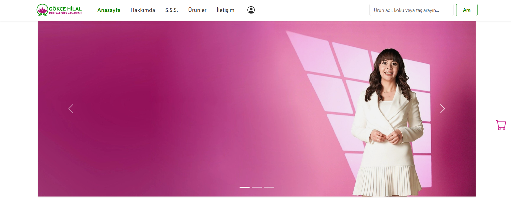
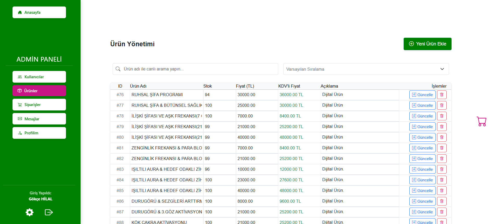
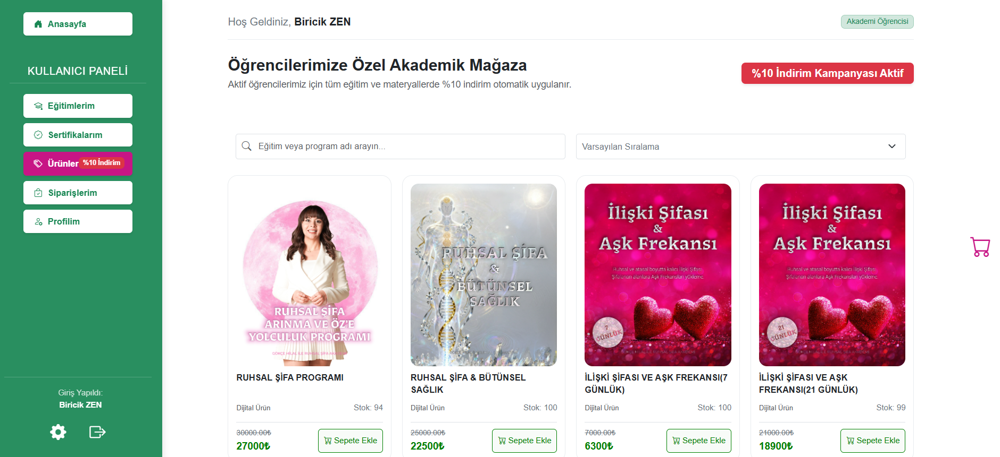
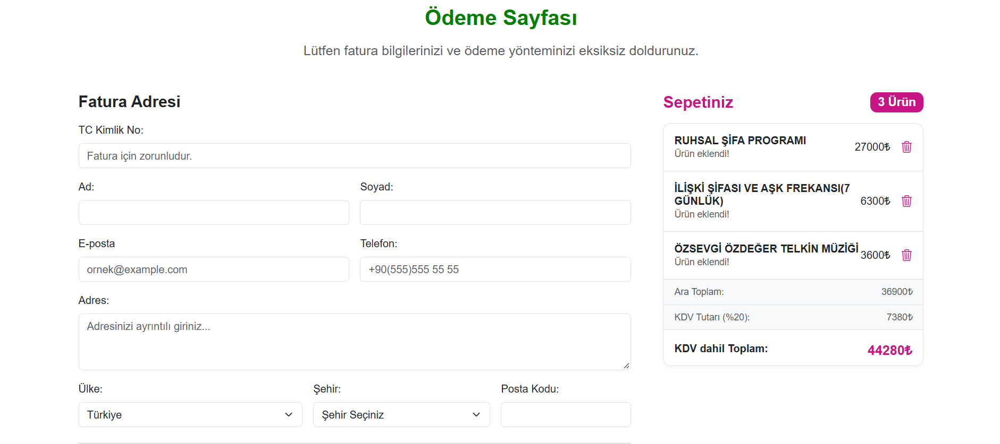

# Gökçe Hilal Akademi — E-Ticaret & Eğitim Yönetim Platformu

**Gökçe Hilal Akademi** (*Unityverse Academy Project*), ruhsal şifa programları, dijital eğitim içerikleri, telkin müzikleri, aromaterapi ve doğal taş ürünlerinin satışını ve yönetimini tek bir çatı altında sunan tam kapsamlı (**Full-Stack**) bir web uygulamasıdır.

Proje; **Vue.js 3** tabanlı modern ve duyarlı bir ön yüz ile **Node.js / Express.js** ve **MySQL** tabanlı güvenli bir arka yüz mimarisi üzerine inşa edilmiştir.

**Sürüm:** 1.0.0  
**Durum:** Aktif / Kararlı

---

## Temel Özellikler

### Ziyaretçi ve Mağaza Deneyimi
* **Çok Görselli Ürün Kataloğu:** Her ürün için 3 ayrı görsel sunumu, detaylı ürün açıklamaları ve gerçek zamanlı arama/filtreleme motoru.
* **Kalıcı Alışveriş Sepeti:** `localStorage` ve Vue reaktif state senkronizasyonu ile tarayıcı yenilense dahi korunan, yan çekmece (sidebar) formatında sepet deneyimi.
* **Ödeme ve Sipariş Akışı (`/checkout`):** Sepetteki ürünlerin onaylanması, sipariş kaydının veritabanına işlenmesi ve ilgili ürünlerin stok miktarlarının arka planda otomatik düşürülmesi.
* **İletişim ve SSS Modülleri:** Ziyaretçilerin doğrudan yönetime mesaj gönderebileceği iletişim formu ve sıkça sorulan sorular bölümü.

### Yönetim Paneli (`/admin`)
* **Ürün Yönetimi (`admin-products.vue`):** `Multer` entegrasyonu ile 3 adet görsel yükleyerek yeni ürün oluşturma, 100'er adımlı fiyat/stok güncelleme ve ürün silme.
* **Sipariş Yönetimi (`admin-orders.vue`):** Gelen tüm siparişlerin listelenmesi, sipariş detaylarının incelenmesi ve sipariş durumlarının güncellenmesi.
* **Kullanıcı Yönetimi (`admin-users.vue`):** Kayıtlı üyelerin bilgilerini tablo üzerinden satır içi (inline) düzenleme, kullanıcı/admin rolü (`0` / `1`) atama ve onay modalı ile hesap silme.
* **Mesaj Yönetimi (`admin-messages.vue`):** İletişim formundan gelen mesajların listelenmesi, okundu/okunmadı takibi ve silinmesi.
* **Admin Profil & Güvenlik (`admin-profile.vue`):** Yönetici hesap özeti, iletişim bilgisi güncelleme ve parola değiştirme.

### Öğrenci / Kullanıcı Paneli (`/user`)
* **Eğitimlerim & Sertifikalarım:** Öğrencinin erişimine açılan eğitim materyalleri ve sertifika görüntüleme alanı.
* **Üyelere Özel İndirimli Mağaza:** Akademi öğrencilerine özel **%10 indirim** avantajlı ürün listeleme ekranı.
* **Sipariş Geçmişim:** Kullanıcının kendi e-posta adresine ait geçmiş siparişlerinin durum takibi.
* **Kullanıcı Profili (`user-profile.vue`):** Kişisel bilgilerin canlı önizleme kartı ile görüntülenmesi, güncellenmesi ve şifre yenileme.

---

## Güvenlik ve Kimlik Doğrulama Mimarisi

* **JWT (JSON Web Token) Tabanlı Oturum:** Giriş yapan kullanıcılara ID ve rol bilgisini içeren şifreli token atanır ve `sessionStorage` üzerinde saklanır.
* **Canlı Güvenlik Duvarı (Vue Router Guard):** `/admin` ve `/user` rotalarına erişim öncesinde `/api/verify-token` uç noktası üzerinden canlı yetki sorgusu yapılır. Yetkisiz erişim girişimleri otomatik olarak `/403` sayfasına yönlendirilir.
* **Merkezi Form Doğrulama (`validation.js`):** Kayıt ve giriş işlemlerinde e-posta formatı, telefon numarası ve en az 6 karakterli şifre kuralları merkezi olarak denetlenir.

---

## API Uç Noktaları (Endpoints)

| Metot | Uç Nokta (Endpoint) | Açıklama | Yetki |
| :--- | :--- | :--- | :--- |
| `POST` | `/api/register` | Yeni kullanıcı kaydı oluşturur (`u_role: "0"`). | Genel |
| `POST` | `/api/login` | Kullanıcı doğrulaması yapar ve JWT token üretir. | Genel |
| `POST` | `/api/verify-token` | Gönderilen JWT token'ın geçerliliğini ve canlı rolünü doğrular. | Oturumlu |
| `POST` | `/api/get-profile` | Token sahibinin ad, soyad, e-posta ve telefon bilgilerini getirir. | Oturumlu |
| `PUT` | `/api/update-profile` | Kullanıcının profil bilgilerini ve isteğe bağlı parolasını günceller. | Oturumlu |
| `GET` | `/api/users` | Tüm kayıtlı kullanıcıları listeler. | Admin |
| `PUT` | `/api/users/:id` | Seçilen kullanıcının bilgilerini ve rolünü günceller. | Admin |
| `DELETE` | `/api/users/:id` | Seçilen kullanıcıyı veritabanından siler. | Admin |
| `GET` / `POST` | `/api/products` | Ürünleri listeler veya 3 görselli yeni ürün ekler. | Genel / Admin |
| `GET` / `POST` | `/api/orders` | Siparişleri listeler veya yeni sipariş oluşturup stokları günceller. | Genel / Admin |

---

## Kullanılan Teknolojiler

### Frontend (Ön Yüz)
* **Vue.js 3** (Options API & Composition API)
* **Vue Router 4** (Navigation Guards & Rol Bazlı Erişim Kontrolü)
* **Bootstrap 5 & Bootstrap Icons** (Responsive Arayüz ve Özel Bildirim Kartları)
* **Vite** (Hızlı Geliştirme Sunucusu ve Paketleyici)

### Backend (Arka Yüz) & Veritabanı
* **Node.js & Express.js** (RESTful API Sunucusu)
* **MySQL (`mysql2`)** (İlişkisel Veritabanı Yönetimi)
* **JSON Web Token (`jsonwebtoken`)** (Oturum Güvenliği)
* **Multer** (Çoklu Dosya ve Ürün Görseli Yükleme)

---

## Proje Dizin Yapısı

```text
://gokcehilalakademi.com
├── backend/
│   └── sql-db/
│       ├── uploads/                # Yüklenen ürün görsellerinin saklandığı klasör
│       ├── db.js                   # MySQL bağlantı havuzu ayarları
│       ├── server.js               # Express sunucusu, API rotaları, JWT ve Multer ayarları
│       └── package.json            # Backend bağımlılıkları
│
├── frontend/
│   ├── public/                     # Statik dosyalar
│   └── src/
│       ├── assets/                 # Logo, SVG ikonlar ve görseller
│       ├── components/             # Modüler arayüz bileşenleri
│       │   ├── admin-products.vue  # Admin ürün ekleme/düzenleme/silme
│       │   ├── admin-orders.vue    # Admin sipariş yönetimi
│       │   ├── admin-users.vue     # Admin kullanıcı yönetimi
│       │   ├── admin-messages.vue  # Admin mesaj kutusu
│       │   ├── admin-profile.vue   # Admin profil ve şifre ayarları
│       │   ├── user-educations.vue # Öğrenci eğitimleri
│       │   ├── user-sertificates.vue # Öğrenci sertifikaları
│       │   ├── user-products.vue   # Öğrenci indirimli mağazası
│       │   ├── user-orders.vue     # Öğrenci sipariş geçmişi
│       │   ├── user-profile.vue    # Öğrenci profil ve şifre ayarları
│       │   └── sepet.vue           # Kayar alışveriş sepeti bileşeni
│       ├── router/
│       │   └── index.js            # Uygulama rotaları ve JWT güvenlik duvarı
│       ├── views/                  # Ana sayfa görünümleri
│       │   ├── Home.vue            # Anasayfa
│       │   ├── About.vue           # Hakkımda
│       │   ├── Product.vue         # Ürünler mağazası
│       │   ├── faq.vue             # Sıkça Sorulan Sorular
│       │   ├── Contact.vue         # İletişim
│       │   ├── Checkout.vue        # Ödeme ve sipariş tamamlama
│       │   ├── Admin.vue           # Admin ana paneli
│       │   ├── User.vue            # Kullanıcı ana paneli
│       │   └── 403.vue             # Yetkisiz erişim hata sayfası
│       ├── App.vue                 # Ana uygulama kabuğu, Navbar, Footer ve Modallar
│       ├── validation.js           # Merkezi form doğrulama motoru
│       └── main.js                 # Vue uygulama giriş noktası
│
├── package.json                    # Kök dizin yapılandırması
└── README.md                       # Proje dokümantasyonu
```

---

## Ekran Görüntüleri

| Anasayfa & Kurumsal Vitrin | Ürünler Kataloğu & Alışveriş Sepeti |
| :---: | :---: |
|  |  |

| Yönetim Paneli — Ürün Yönetimi | Yönetim Paneli — Profil ve Güvenlik |
| :---: | :---: |
|  |  |

| Öğrenci / Kullanıcı Paneli | Ödeme ve Sipariş Tamamlama |
| :---: | :---: |
|  |  |

---

## Veritabanı Kurulumu (MySQL)

Projeyi yerel bilgisayarınızda çalıştırmadan önce MySQL üzerinde veritabanınızı oluşturup aşağıdaki temel tabloları tek seferde içe aktarabilirsiniz:

```sql
CREATE DATABASE IF NOT EXISTS gokce_akademi CHARACTER SET utf8mb4 COLLATE utf8mb4_unicode_ci;
USE gokce_akademi;

-- Kullanıcılar Tablosu (u_role -> 0: Öğrenci/Kullanıcı, 1: Admin)
CREATE TABLE IF NOT EXISTS users (
    u_id INT AUTO_INCREMENT PRIMARY KEY,
    u_firstName VARCHAR(100) NOT NULL,
    u_lastName VARCHAR(100) NOT NULL,
    u_email VARCHAR(150) NOT NULL UNIQUE,
    u_tel VARCHAR(20),
    u_pass VARCHAR(255) NOT NULL,
    u_role VARCHAR(5) DEFAULT '0',
    u_active TINYINT(1) DEFAULT 1,
    created_at TIMESTAMP DEFAULT CURRENT_TIMESTAMP
);

-- Ürünler Tablosu (3 Görsel Destekli)
CREATE TABLE IF NOT EXISTS products (
    p_id INT AUTO_INCREMENT PRIMARY KEY,
    p_name VARCHAR(200) NOT NULL,
    p_stock INT DEFAULT 0,
    p_price DECIMAL(10, 2) NOT NULL,
    p_desc TEXT,
    p_img1 VARCHAR(255),
    p_img2 VARCHAR(255),
    p_img3 VARCHAR(255),
    created_at TIMESTAMP DEFAULT CURRENT_TIMESTAMP
);

-- Siparişler Tablosu
CREATE TABLE IF NOT EXISTS orders (
    o_id INT AUTO_INCREMENT PRIMARY KEY,
    customer_name VARCHAR(150) NOT NULL,
    customer_email VARCHAR(150) NOT NULL,
    customer_tel VARCHAR(20),
    customer_address TEXT,
    order_items JSON NOT NULL,
    total_price DECIMAL(10, 2) NOT NULL,
    order_status VARCHAR(50) DEFAULT 'Yeni Sipariş',
    created_at TIMESTAMP DEFAULT CURRENT_TIMESTAMP
);

-- İletişim Mesajları Tablosu
CREATE TABLE IF NOT EXISTS messages (
    m_id INT AUTO_INCREMENT PRIMARY KEY,
    m_name VARCHAR(150) NOT NULL,
    m_email VARCHAR(150) NOT NULL,
    m_subject VARCHAR(200),
    m_message TEXT NOT NULL,
    is_read TINYINT(1) DEFAULT 0,
    created_at TIMESTAMP DEFAULT CURRENT_TIMESTAMP
);
```

---

## Geliştirme ve Test Ortamı Bilgileri

* **Alan Adı Hedefi:** `://gokcehilalakademi.com`
* **Yerel Ön Yüz (Frontend):** `http://localhost:5173`
* **Yerel Arka Yüz (Backend API):** `http://localhost:3001`
* **Not:** Güvenlik gereği veritabanı şifreleri ve JWT gizli anahtarları (`.env`) repoya dahil edilmemiştir; kurulum sırasında `backend/sql-db` dizininde kendi ortam değişkenlerinizi tanımlamanız yeterlidir.

---


## Kurulum ve Çalıştırma

### 1. Depoyu Klonlayın
```bash
git clone https://github.com
cd ://gokcehilalakademi.com
```

### 2. Backend Kurulumu ve Başlatma
```bash
cd backend/sql-db
npm install
```
MySQL veritabanı bağlantı bilgilerinizi `db.js` (veya `.env`) dosyasında tanımladıktan sonra sunucuyu başlatın:
```bash
node server.js
```
*Sunucu varsayılan olarak `http://localhost:3001` portunda çalışacaktır.*

### 3. Frontend Kurulumu ve Başlatma
Yeni bir terminal açarak `frontend` klasörüne geçin ve geliştirme sunucusunu başlatın:
```bash
cd frontend
npm install
npm run dev
```

---

## Lisans ve Telif Hakkı

**Gökçe Hilal Akademi** — *Unityverse Academy Project*  
© 2026 Gökçe Hilal. Tüm Hakları Saklıdır.
